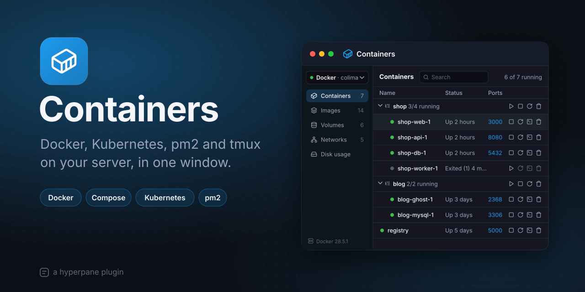

# Containers

Docker, Kubernetes, pm2 and tmux on your server, in one window. Containers
is laid out as Docker Desktop is, but it shows whatever runs on the server
the app is connected to: your Compose projects, your pods, your pm2
processes and your tmux sessions, each with its logs, files and a shell a
click away.

## Features

- **Every manager it finds:** Docker (each context: Docker Desktop,
  OrbStack, Colima, Rancher Desktop, a remote host), Podman, nerdctl,
  Kubernetes (each kubectl context), pm2, tmux and screen, in a switcher.
- **Containers by Compose project:** start, stop, restart or bring down a
  whole project, or one container; ports open in your browser with a
  click.
- **A page for each container:** **Logs** (search, times, copy),
  **Inspect** (searchable JSON), **Files** (walk its folders, read a file,
  copy it into your project), and **Stats** (CPU and memory charts,
  network, disk, processes).
- **Images, volumes, networks:** pull an image and run it (name, ports,
  variables, volumes, restart, command), see its layers, and clean up what
  nothing uses.
- **Disk usage:** what images, containers, volumes and the build cache
  take, and what can be freed.
- **Kubernetes:** pods (and why one waits: CrashLoopBackOff and the like),
  deployments to scale and restart, services; logs, Describe with events,
  files and a shell.
- **pm2, tmux, screen:** pm2's processes with CPU, memory and restarts;
  tmux and screen sessions, with what's on their screen and Attach.
- **A shell in one click:** in a Terminal window, inside a container, a
  pod, or a tmux or screen session.

## How to use

1. Open Containers: **+** on the project, **New containers**, or
   right-click the canvas.
2. Pick a manager at the top of the sidebar (● answers, ○ doesn't, and
   says why).
3. Pick what to see in the sidebar: Containers, Images, Volumes,
   Networks, Disk usage (Pods, Deployments and Services for Kubernetes).
4. Use the buttons on a row to start, stop, restart, open a shell or
   remove; click the row to open its page.
5. Drag the sidebar's edge to make it wider; double-click it for the usual
   width.

## What you can do

### Docker, Podman, nerdctl

| Sidebar | List | Page |
| --- | --- | --- |
| **Containers** | by Compose project (start, stop, restart, down a whole project) or pod; status, ports (click to open); start, stop, restart, shell, remove; only running | **Logs**, **Inspect**, **Files**, **Stats**; stop, pause, restart, kill, shell, remove |
| **Images** | name, id, created, size; **Pull**, clean up | **Layers**, **Inspect**, **Run** |
| **Volumes** | what uses each; clean up | Inspect, remove |
| **Networks** | built-in ones marked; clean up | Inspect, remove |
| **Pods** (Podman) | start, stop, remove | Inspect |
| **Disk usage** | images, containers, volumes, build cache: size and what can be freed; clean up stopped containers, dangling or unused images, unused volumes and networks, the build cache, or everything unused | |

### Kubernetes

By namespace (or all): **Pods** (why one waits, readiness, restarts,
node; Logs per container, **Describe** with its events, Files, Inspect, a
shell, delete), **Deployments** (scale, restart a rollout, Describe,
Inspect), **Services** (type, cluster IP, ports).

### pm2, tmux, screen

- **pm2:** its processes with status, CPU, memory, restarts, uptime and
  mode; start, stop, restart, reload, delete; Logs, Inspect.
- **tmux, screen:** sessions, attached or not; **Screen** (what's on it,
  with its scrollback, refreshed every 2 seconds), **Attach** in a Terminal
  window, end.

## Permissions

| Permission | Why |
| --- | --- |
| `terminal` | **Shell** and **Attach** open a Terminal window in the project, typing `docker exec -it …`, `kubectl exec`, `tmux attach` or `screen -x` for you. |

## Good to know

- **It needs the tools on the server:** Docker, Podman, nerdctl, kubectl,
  pm2, tmux or screen. A manager that isn't installed is listed with how to
  get it.
- **Your current context never changes:** every command names its Docker
  or kubectl context.
- **Removing, deleting, killing, down and cleaning up ask first.**
- A container without a shell can't have its folders walked, but a file
  can still be opened by its path. Reading, copying and saving files work
  on stopped containers too.

## How it works

The server part runs the managers' own command lines on the server, so it
sees what you'd see there: your contexts, your kubeconfig, your
permissions. Tools are looked for on the PATH and where they install
themselves (Homebrew, Docker Desktop, OrbStack, Rancher Desktop, Podman,
npm, Volta, Bun, pnpm, nvm), since a server the app starts may have a
short PATH.

- Contexts are named on every command (`--context`).
- Names, ids, paths, ports and variables are checked before they reach a
  command line, and passed as arguments, never into a shell.
- A folder in a container is listed by a small `sh` script run in it, with
  the path as its argument (`stat`, as busybox and coreutils have it).
  Reading, copying and saving use `docker cp`.
- Shell runs bash if the container has it, else sh.

## Develop

```sh
./build.sh --test     # with stand-ins for docker, podman, kubectl, pm2, tmux and screen
```

## License

MIT, © 2026 Astralyx. See [LICENSE](LICENSE).
